<!-- SVG artwork and this README are maintained by scripts/build_profile_art.py. -->

  <picture>
    <source media="(max-width: 760px) and (prefers-color-scheme: dark)" srcset="assets/hero-dark-mobile.svg" />
    <source media="(max-width: 760px) and (prefers-color-scheme: light)" srcset="assets/hero-light-mobile.svg" />
    <source media="(prefers-color-scheme: dark)" srcset="assets/hero-dark.svg" />
    <source media="(prefers-color-scheme: light)" srcset="assets/hero-light.svg" />
    
  </picture>

<picture>
    <source media="(max-width: 760px)" srcset="assets/profile-intro-mobile.svg" />
    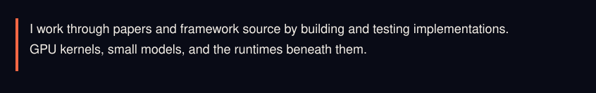
  </picture>

<a href="https://saicharanramineni.com/projects"><picture>
    <source media="(max-width: 760px)" srcset="assets/heading-work-mobile.svg" />
    
  </picture></a>

<a href="https://github.com/GodlyDonuts/psi"><picture>
    <source media="(max-width: 760px)" srcset="assets/work-psi-mobile.svg" />
    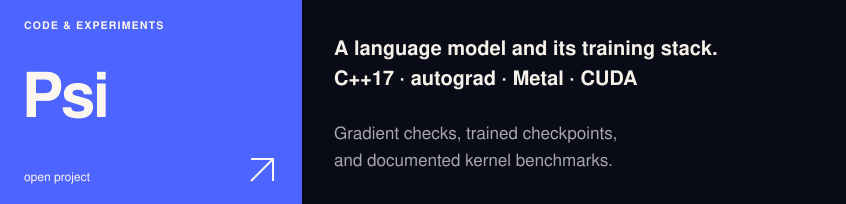
  </picture></a>

<a href="https://github.com/GodlyDonuts/shohin-ettr"><picture>
    <source media="(max-width: 760px)" srcset="assets/work-shohin-mobile.svg" />
    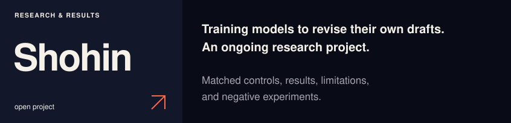
  </picture></a>

<a href="https://github.com/GodlyDonuts/sai"><picture>
    <source media="(max-width: 760px)" srcset="assets/work-sai-mobile.svg" />
    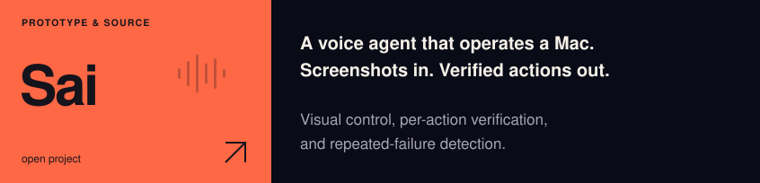
  </picture></a>

<a href="https://saicharanramineni.com/"><picture>
    <source media="(max-width: 760px)" srcset="assets/work-gargantua-mobile.svg" />
    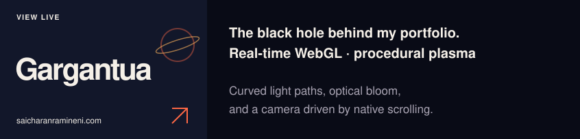
  </picture></a>

<a href="https://saicharanramineni.com/open-source"><picture>
    <source media="(max-width: 760px)" srcset="assets/heading-upstream-mobile.svg" />
    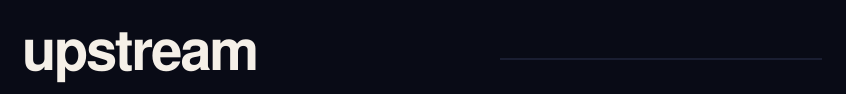
  </picture></a>

<a href="https://github.com/pytorch/pytorch/commit/42a70784390a343ebd90e9e84b1bf5a5df4901f3"><picture>
    <source media="(max-width: 760px)" srcset="assets/upstream-pytorch-mobile.svg" />
    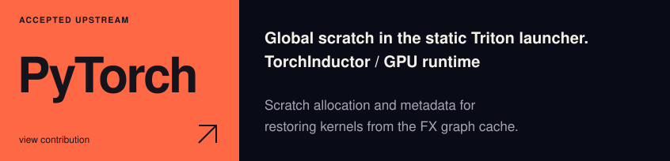
  </picture></a>

<a href="https://github.com/tensorflow/tensorflow/pull/125171"><picture>
    <source media="(max-width: 760px)" srcset="assets/upstream-tensorflow-mobile.svg" />
    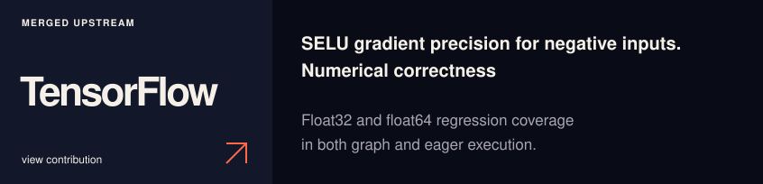
  </picture></a>

  
<picture>
    <source media="(max-width: 760px)" srcset="assets/fold-now-mobile.svg" />
    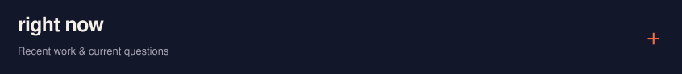
  </picture>

<a href="https://github.com/GodlyDonuts?tab=repositories&amp;sort=updated"><picture>
    <source media="(max-width: 760px)" srcset="assets/now-mobile.svg" />
    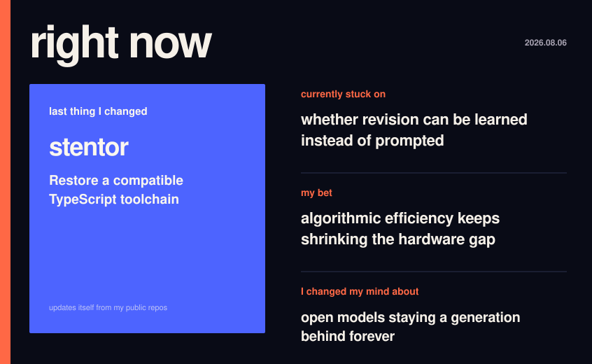
  </picture></a>

  
<picture>
    <source media="(max-width: 760px)" srcset="assets/fold-offscreen-mobile.svg" />
    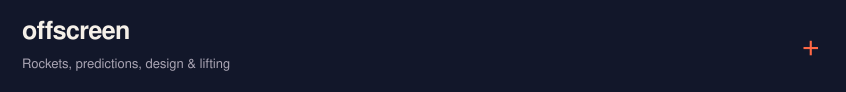
  </picture>

<a href="https://saicharanramineni.com/"><picture>
    <source media="(max-width: 760px)" srcset="assets/offscreen-mobile.svg" />
    
  </picture></a>

<a href="mailto:csramineni@gmail.com"><picture>
    <source media="(max-width: 760px)" srcset="assets/action-email-mobile.svg" />
    
  </picture></a><!--
--><a href="https://saicharanramineni.com/"><picture>
    <source media="(max-width: 760px)" srcset="assets/action-portfolio-mobile.svg" />
    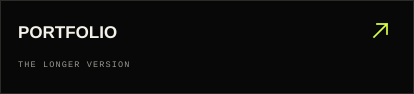
  </picture></a>

<a href="https://www.linkedin.com/in/saicharan-ramineni/"><picture>
    <source media="(max-width: 760px)" srcset="assets/action-linkedin-mobile.svg" />
    
  </picture></a><!--
--><a href="https://saicharanramineni.com/projects"><picture>
    <source media="(max-width: 760px)" srcset="assets/action-projects-mobile.svg" />
    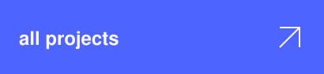
  </picture></a>

