  <picture>
    <source media="(max-width: 760px) and (prefers-color-scheme: dark)" srcset="assets/hero-dark-mobile.svg" />
    <source media="(max-width: 760px) and (prefers-color-scheme: light)" srcset="assets/hero-light-mobile.svg" />
    <source media="(prefers-color-scheme: dark)" srcset="assets/hero-dark.svg" />
    <source media="(prefers-color-scheme: light)" srcset="assets/hero-light.svg" />
    
  </picture>

I'm Sai, a computer science student at UCF working on machine learning systems.

I use implementation and experiments to work through what I read in papers and framework source. That has taken me from gradient checks and GPU kernels to training small language models and fixing upstream runtimes.

[Portfolio](https://saicharanramineni.com/) · [Email](mailto:csramineni@gmail.com) · [LinkedIn](https://www.linkedin.com/in/saicharan-ramineni/)

## Selected work

- **[Psi](https://github.com/GodlyDonuts/psi)** — A small language model and its training stack in C++17: reverse-mode autograd, a transformer, and Metal and CUDA backends. Includes gradient checks, trained checkpoints, and documented kernel benchmarks.
- **[Shohin](https://github.com/GodlyDonuts/shohin-ettr)** — Ongoing research into training language models to revise their own drafts. The repository records matched controls, results, limitations, and negative experiments.
- **[Sai](https://github.com/GodlyDonuts/sai)** — A voice-driven macOS agent prototype that works through screenshots, verifies each action, and detects repeated failures in its control loop.
- **[Gargantua](https://github.com/GodlyDonuts/personal_portfolio)** — The real-time WebGL black hole behind my portfolio: curved light paths, procedural plasma, bloom, and a camera driven by native scrolling. [See it running](https://saicharanramineni.com/).

## Upstream work

- **PyTorch / TorchInductor:** [Global-scratch support in the static Triton launcher](https://github.com/pytorch/pytorch/commit/42a70784390a343ebd90e9e84b1bf5a5df4901f3), including scratch allocation and metadata needed to restore kernels from the FX graph cache.
- **TensorFlow:** [SELU gradient precision for negative inputs](https://github.com/tensorflow/tensorflow/pull/125171), with float32 and float64 regression coverage in graph and eager execution.

[More contributions](https://saicharanramineni.com/open-source) · [All projects](https://saicharanramineni.com/projects)

Outside of code: spaceflight and lifting.
